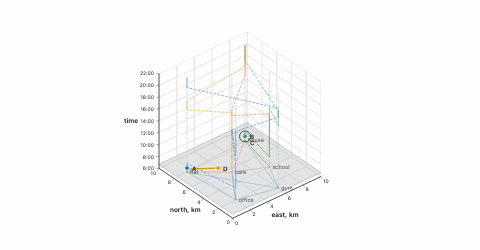
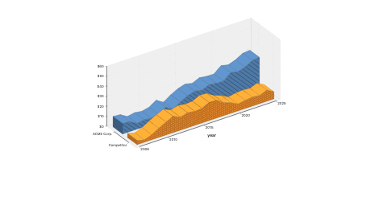
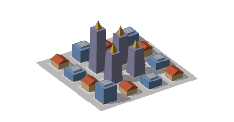
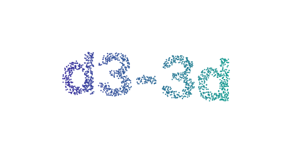
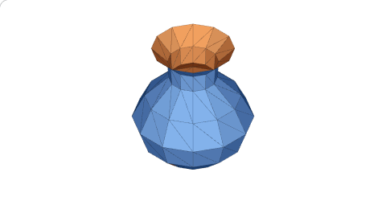
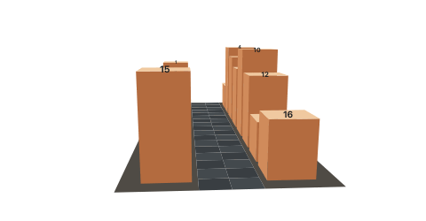

# d3-3d

**3D visualizations for the web, built on [d3.js](https://d3js.org/).** Free and open source, kept alive by one maintainer and the people who sponsor the work.

<a href="https://github.com/sponsors/niekes"></a>

[![Build][build-badge]][build]
[![Coverage][coverage-badge]][coverage]
[](https://fallow.tools/docs/explanations/health/)
[](https://www.npmjs.com/package/d3-3d)
[](https://www.npmjs.com/package/d3-3d)
[](https://github.com/Niekes/d3-3d/blob/master/LICENSE)
[](https://www.npmjs.com/package/d3-3d)

<a href="https://github.com/niekes/d3-3d"></a>
<a href="https://github.com/sponsors/niekes"></a>

<table>
    <tr style="background-color: #f6f8fa">
        <td><a target="_blank" href="https://niekes.github.io/d3-3d/examples/space-time-cube"></a></td>
        <td><a target="_blank" href="https://niekes.github.io/d3-3d/examples/area-chart"></a></td>
        <td><a target="_blank" href="https://niekes.github.io/d3-3d/examples/mini-city"></a></td>
    </tr>
    <tr style="background-color: #f6f8fa">
        <td><a target="_blank" href="https://niekes.github.io/d3-3d/examples/particle-text-morph"></a></td>
        <td><a target="_blank" href="https://niekes.github.io/d3-3d/examples/mesh-inspector"></a></td>
        <td><a target="_blank" href="https://niekes.github.io/d3-3d/examples/perspective-street"></a></td>
    </tr>
</table>

More in the [example gallery](https://niekes.github.io/d3-3d/examples/).

## Sponsor d3-3d

**d3-3d** is free, and it always will be. There is no company behind it — just one maintainer working in spare time — so the cost of keeping it alive is paid for by the people who depend on it.

If d3-3d saves you time, [become a sponsor](https://github.com/sponsors/niekes).

| Tier        | What you get                                                                                |
| ----------- | ------------------------------------------------------------------------------------------- |
| **$5/mo**   | Your name in the [sponsors list](#sponsors) and my sincere thanks                           |
| **$25/mo**  | The above, plus your logo in the README and on the docs site, and priority issue triage     |
| **$100/mo** | The above, plus direct email access for feature requests and a mention in the release notes |

Where the money goes:

- **Issue triage and bug fixes.** Sponsorship buys a reply within a couple of days instead of whenever I get to it.
- **Types that stay correct.** Keeping `index.d.ts` accurate as d3, TypeScript and the DOM move on.
- **The documentation site.** Hosting, builds and the example gallery.
- **Time for new work.** More shapes, better performance, and eventually a WebGL renderer.

Prefer a one-off? The [sponsor page](https://github.com/sponsors/niekes) also takes one-time contributions.

**Need a company sponsorship or an invoice?** [Get in touch](mailto:s@niekes.com).

## Sponsors

Thank you to the people who make this possible. Sponsors at $25/mo and above get their logo in this README and on the docs site; everyone gets their name below.

<!-- New sponsors go below this line, one per line. -->

## Using d3-3d

```bash
npm install d3-3d
```

Everything else lives in the [documentation](https://niekes.github.io/d3-3d/): [getting started](https://niekes.github.io/d3-3d/guide/getting-started), the [API reference](https://niekes.github.io/d3-3d/api/), the [examples](https://niekes.github.io/d3-3d/examples/) and [migrating from v0.x](https://niekes.github.io/d3-3d/guide/migration).

## Star History

[](https://www.star-history.com/#niekes/d3-3d&type=date&legend=bottom-right)

<!-- Definitions -->

[build-badge]: https://github.com/niekes/d3-3d/workflows/main/badge.svg
[build]: https://github.com/niekes/d3-3d/actions
[coverage-badge]: https://img.shields.io/codecov/c/github/niekes/d3-3d.svg
[coverage]: https://codecov.io/github/niekes/d3-3d
