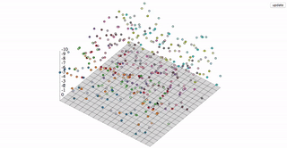
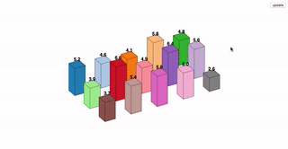
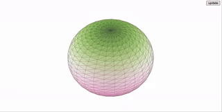

# d3-3d

**d3-3d** is meant for 3d visualizations. **d3-3d** allows the projection of 3d data onto the screen in the webbrowser. It is specially designed to work with **[d3.js](https://d3js.org/)**.

[![Build][build-badge]][build]
[![Coverage][coverage-badge]][coverage]
[](https://fallow.tools/docs/explanations/health/)
[](https://www.npmjs.com/package/d3-3d)
[](https://www.npmjs.com/package/d3-3d)
[](https://github.com/Niekes/d3-3d/blob/master/LICENSE)
[](https://www.npmjs.com/package/d3-3d)

<a href="https://github.com/niekes/d3-3d"></a>
<a href="https://github.com/sponsors/niekes"></a>

<table>
    <tr style="background-color: #f6f8fa">
        <td><a target="_blank" href="https://codepen.io/Niekes/pen/YzBmYzR"></a></td>
        <td><a target="_blank" href="https://codepen.io/Niekes/pen/poGMpLw"></a></td>
        <td><a target="_blank" href="https://codepen.io/Niekes/pen/poGMKXY"> </a></td>
    </tr>
    <tr style="background-color: #f6f8fa">
        <td><a target="_blank" href="https://codepen.io/Niekes/pen/KKEPBVb"></a></td>
        <td><a target="_blank" href="https://codepen.io/Niekes/pen/wvbzGMG"></a></td>
        <td><a target="_blank" href="https://codepen.io/Niekes/pen/eYadJVg"> </a></td>
    </tr>
</table>

See more [examples][examples]

## Sponsor

**d3-3d** is free, and it always will be. There is no company behind it — just one maintainer working in spare time — so the cost of keeping it alive is paid for by the people who depend on it.

If d3-3d saves you time, [become a sponsor](https://github.com/sponsors/niekes).

| Tier        | What you get                                                                                |
| ----------- | ------------------------------------------------------------------------------------------- |
| **$5/mo**   | Your name in the [sponsors list](#sponsors) and my sincere thanks                           |
| **$25/mo**  | The above, plus your logo in the README and on the docs site, and priority issue triage     |
| **$100/mo** | The above, plus direct email access for feature requests and a mention in the release notes |

Where the money goes:

- **Issue triage and bug fixes.** Sponsorship buys a reply within a couple of days instead of whenever I get to it.
- **Types that stay correct.** Keeping `index.d.ts` accurate as d3, TypeScript and the DOM move on.
- **The documentation site.** Hosting, builds and the example gallery.
- **Time for new work.** More shapes, better performance, and eventually a WebGL renderer.

Prefer a one-off? The [sponsor page](https://github.com/sponsors/niekes) also takes one-time contributions.

**Need a company sponsorship or an invoice?** [Get in touch](mailto:s@niekes.com).

## Features

- ✅ **First-class TypeScript support** with full type definitions
- ✅ **Custom data accessor functions** for any data format
- ✅ **Automatic centroid calculation** for all shapes
- ✅ **Counter-clockwise orientation detection** for polygons
- ✅ **Generic types** for type-safe data transformations
- ✅ **Orthographic projection** for SVG rendering
- ✅ **Sorting utilities** for proper z-ordering (painter's algorithm)

## Installing

If you use npm, `npm install d3-3d`. You can also download the [latest release](https://github.com/Niekes/d3-3d/releases). Otherwise use [unpkg](https://unpkg.com/d3-3d/) to get the latest release. For example:

```html
<script src="https://unpkg.com/d3-3d/build/d3-3d.js"></script>
```

For a specific version:

```html
<script src="https://unpkg.com/d3-3d@version/build/d3-3d.js"></script>
```

**TypeScript users:** Type definitions are included automatically. No need to install `@types/d3-3d`.

## Import

ES6 / TypeScript:

```typescript
import {
    triangles3D,
    cubes3D,
    gridPlanes3D,
    points3D,
    lineStrips3D,
    polygons3D,
    planes3D,
    lines3D
} from 'd3-3d';

// Import utility function for sorting
import { sort } from 'd3-3d';

// Import TypeScript types
import type { Point3D, Point2D, TransformedPoint } from 'd3-3d';
```

## API Reference

> **Note:** All shapes (`points3D`, `lines3D`, `lineStrips3D`, `triangles3D`, `planes3D`, `polygons3D`, `gridPlanes3D`, `cubes3D`) share the same API. The methods below work for all shape types.

**Core Methods:**

- [.data()](#data-data) - transform and compute properties for your data.
- [.draw()](#drawshape) - draw SVG path for a shape.

**Configuration Methods:**

- [.x()](#xx) - set the x accessor.
- [.y()](#yy) - set the y accessor.
- [.z()](#zz) - set the z accessor.
- [.scale()](#scalescale) - sets the scale for the projected points.
- [.rotateX()](#rotatexanglex) - set the angle for the x rotation.
- [.rotateY()](#rotateyangley) - set the angle for the y rotation.
- [.rotateZ()](#rotatezanglez) - set the angle for the z rotation.
- [.rotationCenter()](#rotationcenterpoint) - set the rotation center.
- [.origin()](#originorigin) - set the 2D rendering origin.
- [.rows()](#rowsrows) - set the points per row (gridPlanes3D only).

**Utility Functions:**

- [sort()](#sort) - utility function to sort shapes by depth.

### Overview

**d3-3d** uses the [browser's coordinate system](https://www.w3.org/TR/css-transforms-1/#transform-rendering) and [orthographic projection](https://en.wikipedia.org/wiki/Orthographic_projection) to display your data on the screen. It will calculate the centroid for all elements and the orientation for your polygons. Due to the fact that SVG isn't very 3d compatible **d3-3d** adds 3d transformations to SVG.

With **d3-3d** you can easily visualize your 3d data with full TypeScript support.

**Basic Example:**

```typescript
import { triangles3D, sort } from 'd3-3d';

const data3D = [
    [
        { x: 0, y: -1, z: 0 },
        { x: -1, y: 1, z: 0 },
        { x: 1, y: 1, z: 0 }
    ]
];

// Create renderer with default Point3D type
const renderer = triangles3D()
    .scale(100)
    .origin({ x: 480, y: 250 })
    .rotateY(Math.PI / 4);

// Transform data - returns array with computed properties
const transformedData = renderer.data(data3D);

// Each transformed triangle includes:
// - rotated: { x, y, z } - rotated 3D coordinates
// - projected: { x, y } - 2D screen coordinates
// - centroid: { x, y, z } - geometric center
// - ccw: boolean - counter-clockwise orientation

// Render with D3
const svg = d3.select('svg');

svg.selectAll('path')
    .data(transformedData)
    .join('path')
    .attr('d', renderer.draw)
    .attr('fill', 'steelblue');
```

**TypeScript with Custom Data Types:**

```typescript
import { cubes3D, sort, type Point3D } from 'd3-3d';

// Define your domain-specific data type
interface Building {
    lat: number;
    lng: number;
    height: number;
    name: string;
    color: string;
}

// Use generic type for full type safety
const renderer = cubes3D<Building>()
    .x((d) => d.lng)
    .y((d) => d.height)
    .z((d) => d.lat)
    .scale(50)
    .origin({ x: 400, y: 300 });

const buildings: Building[][] = [
    [
        { lat: 0, lng: 0, height: 10, name: 'Building A', color: '#ff6b6b' },
        { lat: 1, lng: 0, height: 15, name: 'Building B', color: '#4ecdc4' },
        { lat: 0.5, lng: 1, height: 20, name: 'Building C', color: '#45b7d1' }
    ]
];

const transformed = renderer.data(buildings);

// TypeScript knows about your custom properties!
transformed[0][0].name; // ✓ string
transformed[0][0].color; // ✓ string
transformed[0].centroid; // ✓ Point3D
transformed[0].ccw; // ✓ boolean

// Sort by depth for proper rendering (back-to-front)
const sorted = transformed.sort(sort);

svg.selectAll('path')
    .data(sorted)
    .join('path')
    .attr('d', renderer.draw)
    .attr('fill', (d) => d[0].color)
    .attr('stroke', 'black');
```

### Shapes

All shapes share the same API for configuration, but differ in their input data format and output properties.

| Shape            | SVG Element | Input Format                           | `.draw()` | `ccw` Property |
| ---------------- | ----------- | -------------------------------------- | --------- | -------------- |
| **points3D**     | `<circle>`  | `Datum[]` - Array of points            | ❌        | ❌             |
| **lines3D**      | `<line>`    | `Datum[][]` - Array of line pairs      | ❌        | ❌             |
| **lineStrips3D** | `<path>`    | `Datum[][]` - Array of point arrays    | ✅        | ❌             |
| **triangles3D**  | `<path>`    | `Datum[][]` - Array of 3-point arrays  | ✅        | ✅             |
| **planes3D**     | `<path>`    | `Datum[][]` - Array of 4-point arrays  | ✅        | ✅             |
| **polygons3D**   | `<path>`    | `Datum[][]` - Array of N-point arrays  | ✅        | ✅             |
| **gridPlanes3D** | `<path>`    | `Datum[]` - Grid of points\*           | ✅        | ✅             |
| **cubes3D**      | `<path>`    | `Datum[][]` - Array of 8-vertex arrays | ✅        | ✅ (per face)  |
| **iso3D**        | `<path>`    | `IsoBoxSpec[]` - Array of boxes        | ❌        | ❌             |
| **axes3D**       | `<path>`    | `AxesSpec` - Domain and ticks per axis | ✅        | ✅ (per wall)  |

**Notes:**

- All shapes compute `centroid`, `rotated`, and `projected` properties
- `ccw` (counter-clockwise) is computed for polygon-based shapes to detect front/back faces
- Shapes without `.draw()` method (`points3D`, `lines3D`) can be rendered directly with SVG elements using the `projected` coordinates

**Input Data Details:**

- **points3D**: Each point must have properties accessible via `.x()`, `.y()`, `.z()` accessors (default: `{x, y, z}`)
- **lines3D**: Each line is defined by exactly 2 points (start and end)
- **lineStrips3D**: Each strip connects consecutive points in the array
- **triangles3D**: Each triangle requires exactly 3 points in counter-clockwise order
- **planes3D**: Each plane requires exactly 4 points in counter-clockwise order
- **polygons3D**: Each polygon can have any number of points (≥3) in counter-clockwise order
- **gridPlanes3D**: Input is a flat array of points that forms a grid. **Important:** You must specify the number of points per row using [.rows()](#rowsrows) so the library can correctly reconstruct the faces. All rows must have the same length.
- **axes3D**: One `{ domain, ticks }` per axis, see [Axes](#axes)
- **cubes3D**: Each cube requires exactly 8 vertices ordered as shown below:


### Isometric scenes

`iso3D` draws an isometric scene. Where the other shapes project a polygon,
it hands out the **affine frame of a face**: the SVG matrix that carries the
local coordinates of the face onto the screen. Because the projection is
orthographic, the image of a plane stays affine, so the browser rasterises
the transform and the projection itself costs nothing at runtime.

```typescript
import { iso3D, sort } from 'd3-3d';

// The isometric view: the angles that map the world axes onto the 120
// degree screen axes.
const iso = iso3D()
    .rotateX(Math.atan(Math.SQRT2))
    .rotateZ(Math.PI / 4)
    .scale(Math.sqrt(1.5));

// Boxes: the visible side and the top face, plus the frame of every face.
const boxes = iso.data([{ x: 0, y: 0, z: 0, w: 100, d: 80, h: 20, r: 6 }]);

// A face: everything inside the group is drawn in the local coordinates
// of the face.
const top = iso.plane({
    origin: { x: 0, y: 0, z: 20 },
    u: { x: 1, y: 0, z: 0 },
    v: { x: 0, y: 1, z: 0 }
});

svg.append('g').attr('transform', top.matrix).append('text').text('Hello');
```

The depth of a box is the `z` of its rotated centre, so the boxes can be
sorted with the same [`sort()`](#sort) utility as every other shape:

```typescript
const sorted = boxes.sort(sort);
```

| Method             | Returns                                            |
| ------------------ | -------------------------------------------------- |
| `.data(boxes)`     | The boxes with their `wall`, `top` and face frames |
| `.plane(spec)`     | The affine frame of a face: `{ matrix }`           |
| `.path(points)`    | The path of a 3D polyline                          |
| `.project(points)` | The screen coordinates of 3D points                |
| `.frame(points)`   | The `viewBox` that frames a projected scene        |

See the [iso stack example](https://niekes.github.io/d3-3d/examples/iso-stack)
for a complete scene.

### Axes

`axes3D` draws the box of a 3D chart: six walls with gridlines and three
axes with their ticks. It works in data units: hand it the domain and the
ticks of every axis, and give it the same accessors as the shapes it
frames, so the box and the data turn as one.

```typescript
import { axes3D } from 'd3-3d';
import { scaleLinear } from 'd3';

// Every axis spans the box from -1 to 1.
const x = scaleLinear().domain([0, 10]).range([-1, 1]).nice();
const y = scaleLinear().domain([0, 4]).range([-1, 1]).nice();
const z = scaleLinear().domain([-2, 2]).range([-1, 1]).nice();

const box = axes3D()
    .scale(100)
    .origin({ x: 480, y: 250 })
    .x((d) => x(d.x))
    .y((d) => -z(d.z)) // data z is up, the screen y grows downwards
    .z((d) => y(d.y));

const spec = {
    x: { domain: x.domain(), ticks: x.ticks(5) },
    y: { domain: y.domain(), ticks: y.ticks(5) },
    z: { domain: z.domain(), ticks: z.ticks(5) }
};

// The walls behind the data, with their gridlines.
svg.selectAll('path.wall')
    .data(box.data(spec).filter((wall) => !wall.ccw))
    .join('path')
    .attr('class', 'wall')
    .attr('d', box.draw);

// The tick labels of the three axes, pushed away from the box.
const ticks = box.axes(spec).flatMap((edge) => edge.map((tick) => ({ tick, edge })));

svg.selectAll('text.tick')
    .data(ticks)
    .join('text')
    .attr('class', 'tick')
    .attr('x', (d) => d.tick.projected.x + d.edge.normal.x * 10)
    .attr('y', (d) => d.tick.projected.y + d.edge.normal.y * 10)
    .attr('text-anchor', (d) =>
        d.edge.normal.x > 0.3 ? 'start' : d.edge.normal.x < -0.3 ? 'end' : 'middle'
    )
    .text((d) => d.tick[d.edge.axis]);
```

| Method        | Returns                                                                                    |
| ------------- | ------------------------------------------------------------------------------------------ |
| `.data(spec)` | The six walls, `x` lo and hi, `y` lo and hi, `z` lo and hi, with `ccw`, `centroid`, `grid` |
| `.draw(wall)` | The path of a wall: its outline and its gridlines                                          |
| `.axes(spec)` | The three axes `x`, `y`, `z`, each a list of ticks with its `axis` and `normal`            |

A spec holds one `{ domain, ticks }` per axis. A wall is the list of its
four corners. It has `ccw` set when it faces the camera, so the walls
behind the data are the ones without it. `axes3D` winds the corners for the
accessors, so this holds whatever the accessors and the domains: a negated
axis or a reversed domain mirrors the box, and the winding follows.

An axis lies on an edge between a wall that faces the camera and one that
does not, so it runs along the outline of the box, outside the data, and
the edges below the box come first, then the ones left of it. Every tick
keeps its value under the axis key, `tick[edge.axis]`, and `normal` is the
unit screen vector away from the box, square to the edge.

See the [scatter explorer](https://niekes.github.io/d3-3d/examples/scatter-explorer)
for a complete chart.

### API Methods

#### .data(_data_)

Transforms the input data by applying rotation, projection, and computing additional properties.

**Available on:** All shapes

**Parameters:**

- `data: Datum[][]` - Array of shapes, where each shape is an array of data points

**Returns:** `Triangle<Datum>[]` (or `Polygon<Datum>[]`, `Plane<Datum>[]`, etc. depending on the shape)

Transformed shapes with the following properties:

- **Original data preserved** - All properties from your input data are preserved
- `rotated: Point3D` - Rotated 3D coordinates for each point
- `projected: Point2D` - 2D screen coordinates for each point
- `centroid: Point3D` - Computed geometric center of the shape
- `ccw: boolean` - Whether the shape is counter-clockwise oriented (polygons only)

**Example:**

```typescript
const renderer = triangles3D()
    .scale(100)
    .rotateY(Math.PI / 4);

const data = [
    [
        { x: 0, y: 0, z: 0 },
        { x: 1, y: 0, z: 0 },
        { x: 0, y: 1, z: 0 }
    ]
];

const result = renderer.data(data);

// Access computed properties
console.log(result[0].centroid); // { x: 0.33, y: 0.33, z: 0 }
console.log(result[0].ccw); // true
console.log(result[0][0].rotated); // { x: ..., y: ..., z: ... }
console.log(result[0][0].projected); // { x: ..., y: ... }
```

**TypeScript with custom data:**

```typescript
interface CustomPoint {
  x: number;
  y: number;
  z: number;
  id: string;
  value: number;
}

const renderer = triangles3D<CustomPoint>()
  .x((d) => d.x)
  .y((d) => d.y)
  .z((d) => d.z);

const data: CustomPoint[][] = [...];
const result = renderer.data(data);

// Original properties are preserved
result[0][0].id;     // ✓ string
result[0][0].value;  // ✓ number

// Computed properties are added
result[0].centroid;  // ✓ Point3D
result[0].ccw;       // ✓ boolean
```

#### .draw()

Constructs an SVG `<path>` element string based on the transformed shape data.

**Available on:** `lineStrips3D`, `triangles3D`, `planes3D`, `polygons3D`, `gridPlanes3D`, `cubes3D`

**Parameters:**

- `shape: TransformedPoint<Datum>[]` - A single transformed shape (from `.data()` result)

**Returns:** `string` - SVG path string (e.g., `"M0,0L1,0L0.5,1Z"`)

**Example:**

```typescript
const renderer = triangles3D();
const transformed = renderer.data(myData);

// Draw single shape
const pathString = renderer.draw(transformed[0]);

// Use with D3
svg.selectAll('path').data(transformed).join('path').attr('d', renderer.draw);
```

#### .x(_x_)

If _x_ is specified, sets the _x_ accessor to the specified function or number and returns the shape instance for chaining. If _x_ is not specified, returns the current _x_ accessor, which defaults to:

**Available on:** All shapes

```js
function x(p) {
    return p.x;
}
```

This function will be invoked for each point in the input data array.

#### .y(_y_)

If _y_ is specified, sets the _y_ accessor to the specified function or number and returns the shape instance for chaining. If _y_ is not specified, returns the current _y_ accessor, which defaults to:

**Available on:** All shapes

```js
function y(p) {
    return p.y;
}
```

This function will be invoked for each point in the input data array.

#### .z(_z_)

If _z_ is specified, sets the _z_ accessor to the specified function or number and returns the shape instance for chaining. If _z_ is not specified, returns the current _z_ accessor, which defaults to:

**Available on:** All shapes

```js
function z(p) {
    return p.z;
}
```

This function will be invoked for each point in the input data array.

#### .scale(_scale_)

If _scale_ is specified, sets the _scale_ to the specified number and returns the shape instance for chaining. If _scale_ is not specified, returns the current _scale_.

**Available on:** All shapes

_Default:_ `1`

#### .rotateX(_angleX_)

If _angleX_ is specified, sets _angleX_ to the specified number (in radians) and returns the shape instance for chaining. If _angleX_ is not specified, returns the current _angleX_.

**Available on:** All shapes

_Default:_ `0`

_angleX_ should be expressed in radians, for example: `Math.PI / 4`.

#### .rotateY(_angleY_)

If _angleY_ is specified, sets _angleY_ to the specified number (in radians) and returns the shape instance for chaining. If _angleY_ is not specified, returns the current _angleY_.

**Available on:** All shapes

_Default:_ `0`

_angleY_ should be expressed in radians, for example: `Math.PI / 4`.

#### .rotateZ(_angleZ_)

If _angleZ_ is specified, sets _angleZ_ to the specified number (in radians) and returns the shape instance for chaining. If _angleZ_ is not specified, returns the current _angleZ_.

**Available on:** All shapes

_Default:_ `0`

_angleZ_ should be expressed in radians, for example: `Math.PI / 4`.

#### .rotationCenter(_point_)

Sets the center point around which rotations are performed. This is different from `.origin()` which controls the 2D rendering position on the screen.

**Available on:** All shapes

**Parameters:**

- `point?: Point3D` - The 3D point to rotate around

**Returns:**

- If called without arguments: current `Point3D` value
- If called with arguments: `this` (for chaining)

_Default:_ `{ x: 0, y: 0, z: 0 }`

**Example:**

```typescript
const renderer = triangles3D()
    .rotationCenter({ x: 50, y: 50, z: 0 }) // Rotate around point (50,50,0)
    .rotateY(Math.PI / 2);

// The rotation will pivot around (50,50,0) instead of (0,0,0)
```

#### .origin(_origin_)

If _origin_ is specified, sets the 2D rendering origin to the specified point and returns the shape instance for chaining. If _origin_ is not specified, returns the current _origin_.

**Available on:** All shapes

_Default:_ `{ x: 0, y: 0 }`

#### .rows(_rows_)

Sets the number of points per row (columns) for `gridPlanes3D`. Since a grid is passed as a flat array, the library needs to know how many points constitute one horizontal line to correctly create the rectangular faces.

**Available on:** `gridPlanes3D`

**Parameters:**

- `rows?: number` - Number of points per row

**Returns:**

- If called without arguments: current `number`
- If called with arguments: `this` (for chaining)

_Default:_ `1`

**Example:**

```typescript
const points = [
    { x: 0, y: 0, z: 0 },
    { x: 1, y: 0, z: 0 },
    { x: 2, y: 0, z: 0 }, // Row 0
    { x: 0, y: 0, z: 1 },
    { x: 1, y: 0, z: 1 },
    { x: 2, y: 0, z: 1 } // Row 1
];

const grid = gridPlanes3D()
    .rows(3) // 3 points per row
    .data(points);
```

## Utility Functions

### sort()

A comparator function for sorting 3D shapes by their centroid's z-coordinate. Use this with JavaScript's `.sort()` to render shapes in correct depth order (painter's algorithm).

**Usage:**

```typescript
import { triangles3D, sort } from 'd3-3d';

const renderer = triangles3D();
const transformed = renderer.data(data);

// Sort back-to-front for correct rendering
const sorted = transformed.sort(sort);

svg.selectAll('path').data(sorted).join('path').attr('d', renderer.draw);
```

**Type Signature:**

```typescript
function sort<T extends HasCentroid>(a: T, b: T): number;

interface HasCentroid {
    centroid: { z: number };
}
```

### Computed Properties

All shape transformations automatically compute additional properties on the returned data:

#### centroid

The geometric center of the shape in 3D space (after rotation). Available on all shapes.

```typescript
const data = triangles3D().data(myTriangles);
console.log(data[0].centroid); // { x: 1.5, y: 2.0, z: 0.5 }
```

Use this for:

- Sorting shapes by depth
- Calculating bounding boxes
- Finding center points for labels or interaction

#### ccw (Counter-Clockwise)

Boolean indicating whether the polygon is oriented counter-clockwise when viewed from the camera. Useful for backface culling. Available on: **triangles3D**, **polygons3D**, **planes3D**, **cubes3D** (per face).

```typescript
const data = triangles3D().data(myTriangles);
if (data[0].ccw) {
    // Front-facing triangle - render normally
} else {
    // Back-facing triangle - optionally skip or render differently
}
```

**Algorithm:** Uses the shoelace formula on the rotated 2D projection to determine orientation.

#### rotated

3D coordinates after rotation has been applied. Available on each individual point.

```typescript
const data = points3D().data(myPoints);
console.log(data[0].rotated); // { x: number, y: number, z: number }
```

#### projected

2D screen coordinates after orthographic projection. Available on each individual point.

```typescript
const data = points3D().data(myPoints);
console.log(data[0].projected); // { x: number, y: number }
```

## Migration Guide

### Upgrading from v0.x to v1.0

The API has been modernized with a new `.data()` method pattern for better TypeScript support and clarity.

**Before (v0.x):**

```javascript
const triangles = triangles3D();
const result = triangles(data); // Called as function
```

**After (v1.0+):**

```typescript
const renderer = triangles3D();
const result = renderer.data(data); // Explicit .data() method
```

**Breaking Changes:**

1. ❌ Direct function invocation removed: `renderer(data)` no longer works
2. ✅ Use `.data()` method instead: `renderer.data(data)`
3. ✅ Full TypeScript generics support added
4. ✅ Computed properties (`centroid`, `ccw`) now included automatically

**Benefits:**

- Better IDE autocomplete and type inference
- Explicit API that's easier to understand
- No confusion between configuration and data transformation
- Full type safety with custom data structures

**Migration Example:**

```diff
- const triangles = triangles3D().scale(100);
- const result = triangles(data);
+ const renderer = triangles3D().scale(100);
+ const result = renderer.data(data);

  svg.selectAll('path')
    .data(result)
    .join('path')
    .attr('d', triangles.draw);
```

## Sponsors

Thank you to the people who make this possible. Sponsors at $25/mo and above get their logo in this README and on the docs site; everyone gets their name below.

<!-- New sponsors go below this line, one per line. -->

## Star History

[](https://www.star-history.com/#niekes/d3-3d&type=date&legend=bottom-right)

<!-- Definitions -->

[build-badge]: https://github.com/niekes/d3-3d/workflows/main/badge.svg
[build]: https://github.com/niekes/d3-3d/actions
[coverage-badge]: https://img.shields.io/codecov/c/github/niekes/d3-3d.svg
[coverage]: https://codecov.io/github/niekes/d3-3d
[examples]: https://codepen.io/collection/DpmByZ?sort_order=desc&sort_by=id
