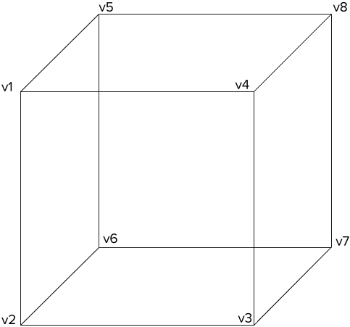

# API Reference

> **Note:** All shapes (`points3D`, `lines3D`, `lineStrips3D`, `triangles3D`, `planes3D`, `polygons3D`, `gridPlanes3D`, `cubes3D`) share the same API. The methods below work for all shape types.

## Shapes

Every factory returns a shape. Its `.data` takes your points and returns them
transformed: each point keeps its fields and gains `rotated` and `projected`,
and each shape gains a `centroid`.

| Shape          | SVG element | Input                                     | `.draw()` | `ccw`       |
| -------------- | ----------- | ----------------------------------------- | --------- | ----------- |
| `points3D`     | `<circle>`  | `Datum[]`, a list of points               | ❌        | ❌          |
| `lines3D`      | `<line>`    | `Datum[][]`, a list of point pairs        | ✅        | ❌          |
| `lineStrips3D` | `<path>`    | `Datum[][]`, a list of point lists        | ✅        | ❌          |
| `triangles3D`  | `<path>`    | `Datum[][]`, a list of 3 point lists      | ✅        | ✅          |
| `planes3D`     | `<path>`    | `Datum[][]`, a list of 4 point lists      | ✅        | ✅          |
| `polygons3D`   | `<path>`    | `Datum[][]`, a list of N point lists      | ✅        | ✅          |
| `gridPlanes3D` | `<path>`    | `Datum[]`, a flat grid of points          | ✅        | ✅          |
| `cubes3D`      | `<path>`    | `Datum[][]`, a list of 8 vertex lists     | ✅        | ✅ per face |
| `iso3D`        | `<path>`    | `IsoBoxSpec[]`, a list of boxes           | ❌        | ❌          |
| `axes3D`       | `<path>`    | `AxesSpec`, the domain and ticks per axis | ✅        | ✅ per wall |

The points of a triangle, plane or polygon go in counter-clockwise order.
`ccw` tells the front from the back face. `points3D` has no `.draw()`: draw
it, or a `lines3D` as `<line>` elements, from the `projected` coordinates.

### `points3D()` {#points3d}

Points. `.data` takes a list of points and returns one point per datum.

### `lines3D()` {#lines3d}

Lines. `.data` takes a list of point pairs and returns one line per pair;
`.draw` draws one as a path, or put a `<line>` on its projected ends.

### `lineStrips3D()` {#linestrips3d}

Line strips. `.data` takes a list of point lists and returns one open
polyline per list.

### `triangles3D()` {#triangles3d}

Triangles. `.data` takes a list of three point lists and returns one
triangle per list, with `ccw` set when it faces the camera.

### `planes3D()` {#planes3d}

Planes. `.data` takes a list of four point lists and returns one plane per
list, with `ccw`.

### `polygons3D()` {#polygons3d}

Polygons. `.data` takes a list of point lists of any length, at least three,
and returns one closed polygon per list, with `ccw`.

### `gridPlanes3D()` {#gridplanes3d}

Grid planes. `.data` takes a flat list of points, `.rows` points per row, and
returns one quad per grid cell, with `ccw`. All rows have the same length.

### `cubes3D()` {#cubes3d}

Cubes. `.data` takes a list of eight point lists and returns one cube per
list, with its six `faces`: `front`, `back`, `left`, `right`, `top` and
`bottom`, each with `ccw`. The eight vertices go in this order, or let `box`
build them:



## Camera {#camera-section}

### `camera3D()` {#camera3d}

A camera without data: the scale, origin, rotation, rotation center and
perspective of a scene. Shapes hang on it with `.camera()`, so turning the
camera turns them all, and the same camera hands its projection to a canvas
or to WebGL. It has the methods of a shape that set and read the view, but
no accessors, no `.data` and no `.draw`.

```typescript
import { camera3D, cubes3D, axes3D, projectPositions } from "d3-3d";

const camera = camera3D().scale(40).origin({ x: 480, y: 250 });
const bars = cubes3D().camera(camera);
const box = axes3D().camera(camera);

camera.rotateY(yaw).rotateX(pitch); // turns the bars and the box

// SVG
svg.selectAll("path").data(faces).join("path").attr("d", bars.draw);

// Canvas
context.fill(new Path2D(bars.draw(face)));
projectPositions(positions, camera.matrix(), screen);

// WebGL
gl.uniformMatrix4fv(
  matrixLocation,
  false,
  camera.matrix({ width, height, depth }),
);
```

## Core Methods

### `.data(data)` {#data}

Transform and compute properties for your data: rotate and project every
point. Your fields stay on every point, the fields of a shape's array stay
on the shape (see [Data on a shape](/guide/getting-started#data-on-a-shape)),
and the result gains:

- `rotated: Point3D`, the rotated point, on every point;
- `projected: Point2D`, the point on the screen, on every point;
- `centroid: Point3D`, the center of the shape;
- `ccw: boolean`, whether a polygon faces the camera.

See [Computed properties](#computed-properties).

```typescript
const triangles = triangles3D()
  .scale(100)
  .rotateY(Math.PI / 4);

const result = triangles.data([
  [
    { x: 0, y: 0, z: 0 },
    { x: 1, y: 0, z: 0 },
    { x: 0, y: 1, z: 0 },
  ],
]);

result[0].centroid; // { x, y, z }
result[0].ccw; // boolean
result[0][0].rotated; // { x, y, z }
result[0][0].projected; // { x, y }
```

### `.draw(shape)` {#draw}

Draw the SVG path for a shape, one item of the `.data` result, as a path
string such as `"M0,0L1,0L0.5,1Z"`. Not on `points3D`.

```typescript
svg
  .selectAll("path")
  .data(triangles.data(data))
  .join("path")
  .attr("d", triangles.draw);
```

### `.unproject(point, planePoint, planeNormal)` {#unproject}

The world point on a plane under a screen point, or `null` when the plane is
seen edge-on or the ray from the eye meets it only behind the eye. The plane
runs through `planePoint` with the normal `planeNormal`, which need not be
normalized. It is the inverse of `.data` for points on a known plane: what
dragging along a floor or reading the coordinates under the pointer needs.

```typescript
const cubes = cubes3D()
  .scale(40)
  .origin({ x: 480, y: 250 })
  .rotateX(-0.5)
  .rotateY(0.6);

svg.on("pointermove", (event) => {
  const [x, y] = d3.pointer(event);
  // The floor: the plane y = 0.
  const floor = cubes.unproject(
    { x, y },
    { x: 0, y: 0, z: 0 },
    { x: 0, y: 1, z: 0 },
  );
});
```

### `.matrix()` {#matrix}

The projection as a column-major 4×4 `Float32Array`, for a WebGL uniform or
for `projectPositions`. It maps a world point to its screen x and y, and its
`rotated` z as the depth: a larger z is nearer the viewer. Use it when the
SVG DOM is too slow for the number of points: `.data` builds an object per
point, the matrix projects millions of them on the GPU.

Given `{ width, height, depth }`, it maps to clip space instead, ready for
`gl_Position`: x and y from -1 to 1 with y up, and the depth from -1 at the
near side to 1 at the far side. `width` and `height` are the size of the
canvas in the pixels of `origin` and `scale`, `depth` the radius of the scene
around the rotation center, in world units; without it, z is 0. With a
perspective the matrix has a w, and the `depth` has to be less than the
distance of the eye.

```typescript
const camera = camera3D()
  .scale(40)
  .origin({ x: 480, y: 250 })
  .rotateX(-0.5)
  .rotateY(0.6);

gl.uniformMatrix4fv(
  matrixLocation,
  false,
  camera.matrix({ width: 960, height: 500, depth: 2 }),
);
```

```glsl
uniform mat4 u_matrix; // camera.matrix({ width, height, depth })
attribute vec3 a_position;

void main() {
    gl_Position = u_matrix * vec4(a_position, 1.0);
}
```

### `.camera(camera)` {#camera}

Share the view of a `camera3D()` or another shape: turning, scaling or
moving either changes both. Call it before the other setters, the shape gives
up the view it had.

### `.viewDirection()` {#viewdirection}

The direction from the scene towards the viewer, a unit vector in world
coordinates: which side of a box shows, which end of a grid is near, the
normal of a plane that faces the camera. The rotated depth of a point `p` is
`dot(viewDirection, p − rotationCenter) + rotationCenter.z`. In perspective
the eye sits at `rotationCenter + perspective · viewDirection`.

```typescript
const v = camera.viewDirection();
const topShows = v.y < 0; // up is -y, as on the screen
const facing = camera.unproject(pointer, grabbed, v); // drag in the plane that faces the camera
```

## Configuration Methods

Every setter returns the shape, so the calls chain. Called without an
argument, it returns the current value.

### `.x(accessor)` {#x}

Set the x accessor, a function of the point. Default: `(p) => p.x`.

### `.y(accessor)` {#y}

Set the y accessor. Default: `(p) => p.y`.

### `.z(accessor)` {#z}

Set the z accessor. Default: `(p) => p.z`.

### `.scale(scale)` {#scale}

Set the scale for the projected points. Default: `1`.

### `.rotateX(angle)` {#rotatex}

Set the angle for the x rotation, in radians. Default: `0`.

### `.rotateY(angle)` {#rotatey}

Set the angle for the y rotation, in radians. Default: `0`.

### `.rotateZ(angle)` {#rotatez}

Set the angle for the z rotation, in radians. Default: `0`.

### `.rotationCenter(point)` {#rotationcenter}

Set the rotation center, the 3D point the rotations pivot around, unlike
`.origin`, which places the scene on the screen. Default: `{ x: 0, y: 0, z: 0 }`.

```typescript
// Pivot around (50, 50, 0) instead of the world origin.
triangles3D()
  .rotationCenter({ x: 50, y: 50, z: 0 })
  .rotateY(Math.PI / 2);
```

### `.origin(origin)` {#origin}

Set the 2D rendering origin. Default: `{ x: 0, y: 0 }`.

### `.perspective(distance)` {#perspective}

Set the distance of the eye from the rotation center, in world units, for a
perspective view, like CSS `perspective`. The default, `Infinity`, is
orthographic. The plane through the rotation center keeps the `scale`; nearer
things grow and farther ones shrink, by
`distance / (distance − (rotated.z − rotationCenter.z))`. A small distance is
a strong perspective. The scene has to lie in front of the eye: WebGL clips
the rest, SVG and a 2D canvas cannot.

`sort` keeps working, since the rotated z is still the depth along the view
axis. `ccw` winds on the screen, `.unproject()` casts its rays from the eye,
and a face faces the eye where `dot(normal, eye − vertex) > 0`. Circles keep
their size: scale a radius by the factor above to shrink the far ones.
`iso3D` stays orthographic.

```typescript
const camera = camera3D()
  .scale(80)
  .origin({ x: 480, y: 250 })
  .rotateY(0.6)
  .perspective(6);
```

### `.rows(rows)` {#rows}

Set the points per row (`gridPlanes3D` only). A grid comes as a flat list,
so the shape needs the row length to build its quads. Default: `1`.

```typescript
const grid = gridPlanes3D()
  .rows(3)
  .data([
    { x: 0, y: 0, z: 0 },
    { x: 1, y: 0, z: 0 },
    { x: 2, y: 0, z: 0 }, // row 0
    { x: 0, y: 0, z: 1 },
    { x: 1, y: 0, z: 1 },
    { x: 2, y: 0, z: 1 }, // row 1
  ]);
```

## Computed properties

### centroid {#centroid-property}

The mean of the rotated points of a shape, on every shape: sort by it, put a
label on it, or hit-test around it.

### ccw {#ccw-property}

Whether a polygon winds counter-clockwise on the screen, by the shoelace
formula on the projected points, so it holds in a perspective too. A
counter-clockwise polygon faces the camera: skip or shade the others for back
face culling. On `triangles3D`, `planes3D`, `polygons3D`, `gridPlanes3D`, the
faces of `cubes3D` and the walls of `axes3D`.

```typescript
const front = triangles3D()
  .data(mesh)
  .filter((t) => t.ccw);
```

### rotated {#rotated-property}

The rotated 3D point, on every point.

### projected {#projected-property}

The point on the screen, orthographic or in perspective, on every point.

## Utility Functions

### `sort(a, b)` {#sort}

Sort shapes by depth (painter's algorithm): a comparator for anything with a
`centroid`, back to front. In a perspective too, the rotated z is the depth.

```typescript
svg
  .selectAll("path")
  .data(triangles.data(data).sort(sort))
  .join("path")
  .attr("d", triangles.draw);
```

Things that stand on one floor, bars or buildings, sort by their footprint:
give each the `centroid` of its `bottom` face. The centre of a tall box sits
high up, so seen from above it would paint over a short box in front of it.
A long line sorts by its middle; cut it with [`strips`](#strips) so every
piece sorts on its own depth.

```typescript
function sort<T extends HasCentroid>(a: T, b: T): number;

interface HasCentroid {
  centroid: { z: number };
}
```

### `ccw(polygon)` {#ccw}

Whether a transformed polygon winds counter-clockwise on the screen, which
means it faces the camera, in a perspective too.

### `centroid(polygon)` {#centroid}

The mean of the rotated points of a transformed polygon.

### `transform(data, options)` {#transform}

Rotate and project a list of points: what `.data` does under the hood.

### `orthographic(point, options)` {#orthographic}

Project a rotated point onto the screen: `{ origin, scale }` in, `Point2D`
out.

### `perspective(point, options)` {#perspective-function}

Project a rotated point as seen from an eye `distance` in front of the
rotation center: `{ origin, scale, rotateCenter, distance }` in, `Point2D`
out. An infinite distance is `orthographic`.

### `projectPositions(positions, matrix, out?)` {#projectpositions}

Project packed x, y, z triples through a `.matrix()` into a `Float32Array` of
screen x, screen y and depth. x and y are divided by the w of a perspective
matrix, the depth stays the rotated z. Reuse `out` to redraw a large point
cloud on a canvas without allocating.

```typescript
const positions = new Float32Array(data.flatMap((d) => [d.x, d.y, d.z]));
const screen = new Float32Array(positions.length);
const camera = camera3D().scale(40).origin({ x: 480, y: 250 });

function frame(angle: number) {
  projectPositions(positions, camera.rotateY(angle).matrix(), screen);
  context.clearRect(0, 0, width, height);
  for (let i = 0; i < screen.length; i += 3) {
    context.fillRect(screen[i] - 1, screen[i + 1] - 1, 2, 2);
  }
}
```

### `normal(polygon)` {#normal}

The unit normal of a polygon by Newell's method, on the side `ccw` reports:
outwards on the faces of `cubes3D`, along `viewDirection` where a face faces
the camera, or towards the eye in perspective. A polygon without an area gets
the zero vector.

```typescript
const sun = { x: 0.5, y: -0.7, z: 0.5 }; // up is -y
const light = (face) => {
  const n = normal(face);
  return Math.max(0.2, n.x * sun.x + n.y * sun.y + n.z * sun.z);
};
```

### `box(spec)` {#box}

The eight corners of a box in the order `cubes3D` expects, standing on
`{ x, y, z }` with its `width`, `depth` and `height`, upwards towards -y.
`topWidth` and `topDepth` taper the top: zero width makes a ridge, zero size
an apex.

```typescript
const bars = data.map((d) =>
  box({ x: d.x, y: 0, z: d.z, width: 1, height: d.value, depth: 1 }),
);
cubes3D().data(bars);
```

### `lathe(profile, segments)` {#lathe}

The triangles of a surface of revolution, for `triangles3D`. The profile is a
list of `{ x, y }`, the radius and the height, turned around the y axis in
`segments` steps. A point with radius 0 closes the surface there, so a
profile from the axis to the axis is a solid. Run it upwards, from a large y
to a small one, and every triangle faces outwards: its `normal` points out
and `ccw` tells the outside from the inside.

```typescript
// A sphere: a half circle from the bottom pole to the top pole.
const profile = [{ x: 0, y: r }];
for (let i = 1; i < 12; i += 1) {
  profile.push({
    x: r * Math.sin((i / 12) * Math.PI),
    y: r * Math.cos((i / 12) * Math.PI),
  });
}
profile.push({ x: 0, y: -r });

const triangles = triangles3D();
const sphere = triangles.data(lathe(profile, 24)).filter((t) => t.ccw);
svg.selectAll("path").data(sphere).join("path").attr("d", triangles.draw);
```

### `strips(points, size)` {#strips}

Cut a polyline into strips of `size` points that share their end points, the
last one shorter if the points run out, so every piece of a long line sorts
on its own depth. A `size` of 2 gives the segments, for `lines3D`.

```typescript
const orbit = lineStrips3D().data(strips(points, 6));
svg
  .selectAll("path")
  .data([...orbit, ...planets].sort(sort))
  .join("path");
```

### `catmullRom(points, steps)` {#catmullrom}

The Catmull–Rom spline through 3D points, `steps` samples per segment, for
`lineStrips3D`. It starts on the first point and ends on the last.

```typescript
const curve = lineStrips3D();
path.attr("d", curve.draw(curve.data([catmullRom(knots, 16)])[0]));
```

### `axisSpec(scale, count?)` {#axisspec-function}

One axis of [`axes3D`](#axes3d) from a d3 scale: its domain and about
`count` of its ticks. Call `.nice()` on the scale first, so the box ends on a
tick. The scale is anything with `domain()` and `ticks(count)`.

## Isometric scenes

### `iso3D()` {#iso3d}

`iso3D` draws an isometric scene. Where the other shapes project a polygon,
it hands out the **affine frame of a face**: the SVG matrix that carries the
local coordinates of the face onto the screen. Because the projection is
orthographic, the image of a plane stays affine, so the browser rasterises
the transform and the projection itself costs nothing at runtime. For the
same reason `iso3D` is always orthographic and ignores `.perspective()`.

```typescript
import { iso3D, sort } from "d3-3d";

// The isometric view: the angles that map the world axes onto the 120
// degree screen axes.
const iso = iso3D()
  .rotateX(Math.atan(Math.SQRT2))
  .rotateZ(Math.PI / 4)
  .scale(Math.sqrt(1.5));

// Boxes: the visible side and the top face, plus the frame of every face.
const boxes = iso.data([{ x: 0, y: 0, z: 0, w: 100, d: 80, h: 20, r: 6 }]);

// A face: everything inside the group is drawn in the local coordinates
// of the face.
const top = iso.plane({
  origin: { x: 0, y: 0, z: 20 },
  u: { x: 1, y: 0, z: 0 },
  v: { x: 0, y: 1, z: 0 },
});

svg.append("g").attr("transform", top.matrix).append("text").text("Hello");
```

A box is `{ x, y, z, w, d, h, r }`: the corner, the extent along the three
axes and the corner radius of its plan outline. The depth of a box is the
`z` of its rotated centre, so the boxes can be sorted with the same
`sort()` utility as every other shape.

See the [office tower example](/examples/iso-tower) for a complete scene.

### `.data(boxes)` {#iso-data}

The boxes with their `wall`, `top` and face frames.

### `.plane(spec)` {#iso-plane}

The affine frame of a face: `{ matrix }`.

### `.path(points)` {#iso-path}

The path of a 3D polyline.

### `.project(points)` {#iso-project}

The screen coordinates of 3D points.

### `.frame(points)` {#iso-frame}

The `viewBox` that frames a projected scene.

## Axes

### `axes3D()` {#axes3d}

`axes3D` draws the box of a 3D chart: six walls with gridlines and three
axes with their ticks. It works in data units: hand it the domain and the
ticks of every axis, and give it the same accessors as the shapes it
frames, so the box and the data turn as one.

```typescript
import { axes3D, axisSpec } from "d3-3d";
import { scaleLinear } from "d3";

// Every axis spans the box from -1 to 1.
const x = scaleLinear().domain([0, 10]).range([-1, 1]).nice();
const y = scaleLinear().domain([0, 4]).range([-1, 1]).nice();
const z = scaleLinear().domain([-2, 2]).range([-1, 1]).nice();

const box = axes3D()
  .scale(100)
  .origin({ x: 480, y: 250 })
  .x((d) => x(d.x))
  .y((d) => -z(d.z)) // data z is up, the screen y grows downwards
  .z((d) => y(d.y));

const spec = { x: axisSpec(x, 5), y: axisSpec(y, 5), z: axisSpec(z, 5) };

// The walls behind the data, with their gridlines.
svg
  .selectAll("path.wall")
  .data(box.data(spec).filter((wall) => !wall.ccw))
  .join("path")
  .attr("class", "wall")
  .attr("d", box.draw);

// The tick labels of the three axes, pushed away from the box.
const ticks = box
  .axes(spec)
  .flatMap((edge) => edge.map((tick) => ({ tick, edge })));

svg
  .selectAll("text.tick")
  .data(ticks)
  .join("text")
  .attr("class", "tick")
  .attr("x", (d) => d.tick.projected.x + d.edge.normal.x * 10)
  .attr("y", (d) => d.tick.projected.y + d.edge.normal.y * 10)
  .attr("text-anchor", (d) =>
    d.edge.normal.x > 0.3 ? "start" : d.edge.normal.x < -0.3 ? "end" : "middle",
  )
  .text((d) => d.tick[d.edge.axis]);
```

A spec holds one `{ domain, ticks }` per axis. A wall is the list of its
four corners. It has `ccw` set when it faces the camera, so the walls
behind the data are the ones without it. `axes3D` winds the corners for the
accessors, so this holds whatever the accessors and the domains: a negated
axis or a reversed domain mirrors the box, and the winding follows.

An axis lies on an edge between a wall that faces the camera and one that
does not, so it runs along the outline of the box, outside the data, and
the edges below the box come first, then the ones left of it. Every tick
keeps its value under the axis key, `tick[edge.axis]`, and `normal` is the
unit screen vector away from the box, square to the edge.

See the [scatter plot](/examples/scatter-plot) for a complete chart.

### `.data(spec)` {#axes-data}

The six walls, `x` lo and hi, `y` lo and hi, `z` lo and hi, with `ccw`,
`centroid` and `grid`. Every wall names the `axis` it stands across and its
`side`, 0 at the first value of the domain and 1 at the last, so the floor
of a chart whose data z is up is the wall with `axis === 'z'`.

### `.draw(wall)` {#axes-draw}

The path of a wall: its outline and its gridlines.

### `.axes(spec)` {#axes-axes}

The three axes `x`, `y`, `z`, each a list of ticks with its `axis` and
`normal`.

## Types

```typescript
import type { Point3D, Point2D, TransformedPoint } from "d3-3d";
```

### `Point3D` {#point3d}

```typescript
type Point3D = { x: number; y: number; z: number };
```

### `Point2D` {#point2d}

```typescript
type Point2D = { x: number; y: number };
```

### `TransformedPoint` {#transformedpoint}

A datum after `.data`: your fields plus the rotated and the projected point.

```typescript
type TransformedPoint<T> = T & { rotated: Point3D; projected: Point2D };
```

### `AxesSpec` {#axesspec}

The three axes of a chart box, the input of `axes3D`.

```typescript
interface AxesSpec {
  x: AxisSpec;
  y: AxisSpec;
  z: AxisSpec;
}
```

### `AxisSpec` {#axisspec}

One axis in data units: its extent, from the first to the last value of
`domain`, and the values of its ticks.

```typescript
interface AxisSpec {
  domain: number[];
  ticks: number[];
}
```

### `IsoBoxSpec` {#isoboxspec}

An axis aligned box in world space, the input of `iso3D`.

```typescript
interface IsoBoxSpec {
  x: number;
  y: number;
  z: number;
  w: number;
  d: number;
  h: number;
  r?: number;
}
```

### `IsoPlaneSpec` {#isoplanespec}

A rectangle in world space: its corner and the two vectors that span it.

```typescript
interface IsoPlaneSpec {
  origin: Point3D;
  u: Point3D;
  v: Point3D;
}
```
